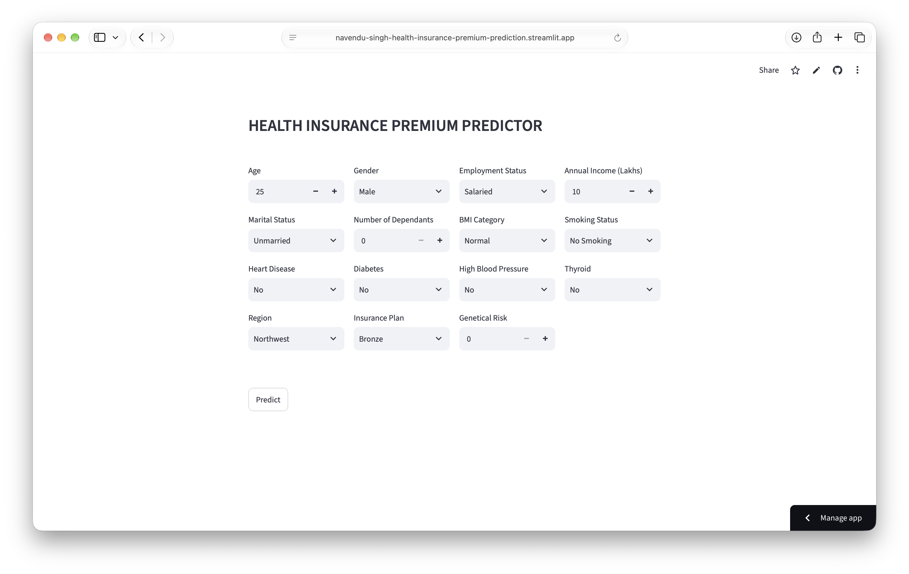
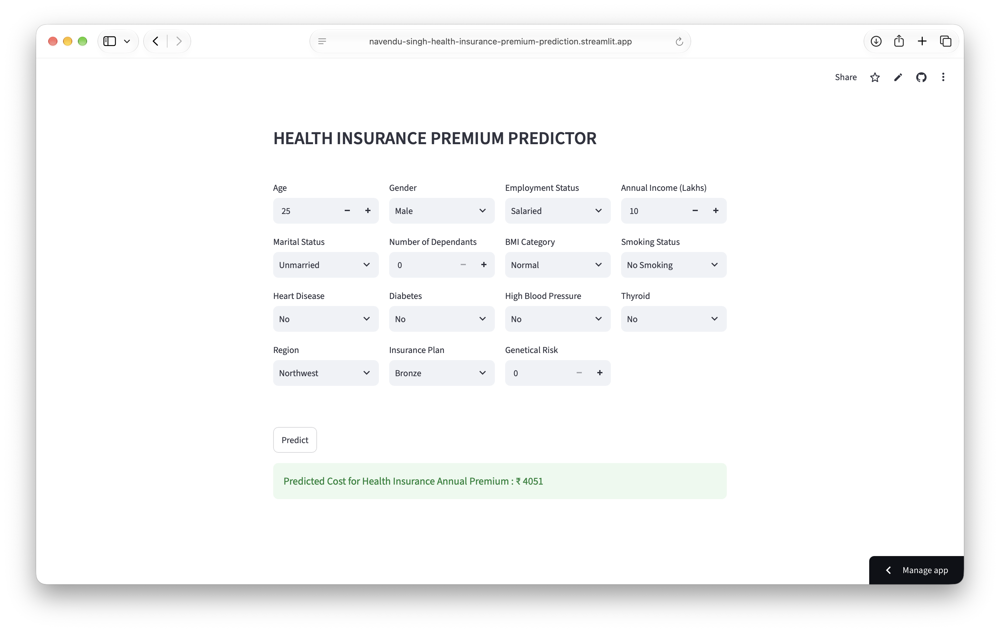
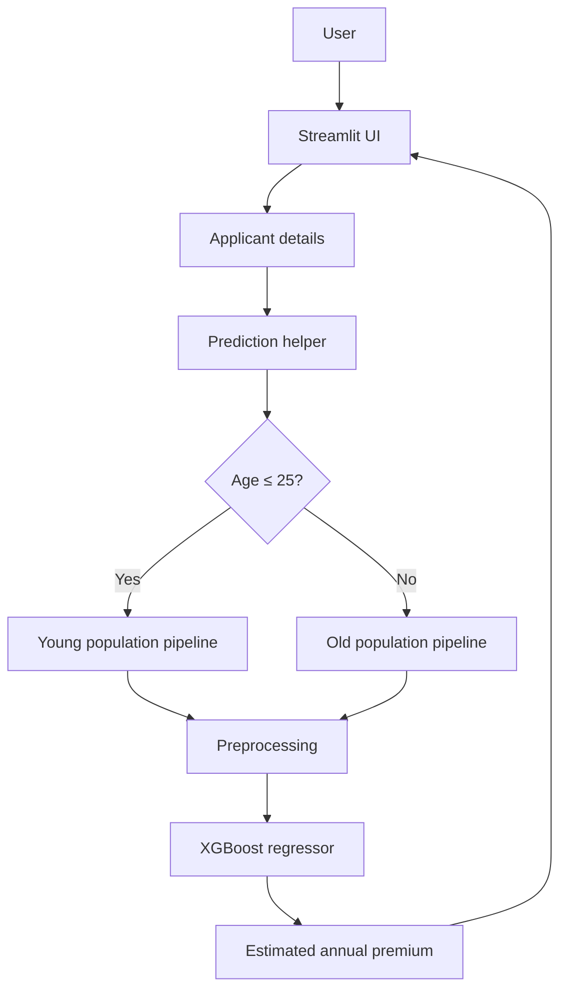

<div align="center">

# Health Insurance Premium Prediction

**An underwriting support tool that estimates annual health insurance premiums from applicant risk and policy details.**

<p align="center">
  
  
  
  
</p>

[Open the live application](https://navendu-singh-health-insurance-premium-prediction.streamlit.app)

</div>

## Application Preview

#### Underwriter Input Form


#### Premium Estimate for Underwriter Review


#### Accessing the Live Application
The application is hosted on Streamlit Community Cloud. If it has gone to sleep after a period of inactivity, open the live demo link and select **"Yes, get this app back up!"** when prompted. Wait for the app to start before entering applicant details.

---

## Overview

Health Insurance Premium Prediction is a regression-based underwriting support application. It helps an **insurance underwriter estimate an applicant's annual health insurance premium** using demographic, financial, lifestyle, and health-related information.

The project includes an exploratory modelling workflow, separately trained models for two age groups, and a Streamlit application designed for an underwriter's use during premium assessment. The application selects the appropriate saved model based on the applicant's age and returns an estimated annual premium in Indian rupees (₹).

## Key Features

- **Age-segmented prediction:** Uses separate XGBoost models for applicants aged 25 or younger and applicants older than 25.
- **Feature engineering:** Combines selected medical conditions into a weighted health-risk score.
- **Structured preprocessing:** Uses scikit-learn's `ColumnTransformer` and `Pipeline` for numerical scaling and categorical encoding.
- **Model experimentation:** Compares Linear Regression, Decision Tree, Random Forest, and XGBoost regression.
- **Model persistence:** Saves trained preprocessing-and-model pipelines with Joblib.
- **Interactive application:** Provides a Streamlit interface for entering applicant information and obtaining a premium estimate.

## How It Works

1. The underwriter enters the applicant's details in the Streamlit interface.
2. The application creates a weighted health-risk score from the selected medical conditions.
3. The applicant's age determines which saved model is selected:
   - Age ≤ 25: young-population model.
   - Age > 25: old-population model.
4. The input is converted into a DataFrame with the feature names expected by that model.
5. The saved pipeline applies preprocessing and predicts the annual premium.
6. The application displays the predicted amount in ₹.

### Application architecture



## Model Development

The notebooks document the data preparation, exploratory analysis, feature engineering, preprocessing, model comparison, evaluation, and model export workflows.

### Data preparation and feature engineering

The modelling workflow includes:

- Inspecting data types, missing values, duplicate records, and numerical distributions.
- Handling missing values and investigating implausible values and outliers.
- Separating numerical, nominal categorical, and ordinal categorical features.
- Creating a combined health-risk feature from four medical conditions.

The health-risk score uses the following weights:

| Medical condition | Weight |
|---|---:|
| Heart disease | 8 |
| Diabetes | 6 |
| High blood pressure | 6 |
| Thyroid | 5 |

The maximum possible weighted score is 25. The training notebooks scale this feature to a 0–1 range.

### Preprocessing

The scikit-learn preprocessing pipeline uses:

| Feature type | Transformation |
|---|---|
| Nominal categorical | One-hot encoding |
| Ordinal categorical | Ordinal encoding with explicitly defined category order |
| Numerical | Standard scaling |

The fitted preprocessor is stored together with the regressor in a scikit-learn `Pipeline`, ensuring that inference uses the same fitted transformations as training.

### Models evaluated

The initial modelling notebook compares:

- Linear Regression
- Decision Tree Regressor
- Random Forest Regressor
- XGBoost Regressor

The age-specific modelling notebooks train and export XGBoost pipelines for the two applicant groups.

### Reported test-set performance

The following values are taken from the saved notebook outputs. They represent the notebook evaluation results, not an independent validation of the deployed Streamlit application.

| Model segment | Test MAE | Test RMSE | Test R² |
|---|---:|---:|---:|
| Applicants aged 25 or younger | ₹266.36 | ₹311.59 | 0.9873 |
| Applicants older than 25 | ₹262.75 | ₹311.97 | 0.9980 |

The age-specific notebooks use a 70/30 train-test split with `random_state=42`.

### Initial model comparison

The general-population notebook reports the following test-set results:

| Regressor | Test MAE | Test RMSE | Test R² |
|---|---:|---:|---:|
| Linear Regression | ₹1,800.19 | ₹2,317.42 | 0.9239 |
| XGBoost | ₹780.04 | ₹1,170.37 | 0.9806 |
| Random Forest | ₹803.62 | ₹1,216.23 | 0.9790 |
| Decision Tree | ₹1,038.27 | ₹1,630.33 | 0.9624 |

**Metrics:** MAE (Mean Absolute Error), RMSE (Root Mean Squared Error), and R² (coefficient of determination). Lower MAE/RMSE and higher R² indicate better performance.

## Tech Stack

| Area | Tools |
|---|---|
| Language | Python |
| Data manipulation | Pandas, NumPy |
| Visualisation and EDA | Matplotlib, Seaborn |
| Machine learning | Scikit-learn, XGBoost |
| Model serialization | Joblib |
| Application | Streamlit |
| Development | Jupyter Notebook |

## Repository Structure

```text
health-insurance-premium-prediction/
│
├── artifacts/
│   ├── old_population_model.joblib
│   └── young_population_model.joblib
│
├── screenshots/
│   ├── app-interface.png
│   └── prediction-result.png
│
├── 1-notebook-premium-prediction.ipynb
├── 2-old-premium-prediction.ipynb
├── 3-young-premium-prediction.ipynb
│
├── main.py
├── prediction_helper.py
├── requirements.txt
└── README.md
```

- `1-notebook-premium-prediction.ipynb` — initial exploratory analysis, preprocessing experiments, and comparison of regression models.
- `2-old-premium-prediction.ipynb` — model development and evaluation for applicants older than 25.
- `3-young-premium-prediction.ipynb` — model development and evaluation for applicants aged 25 or younger.
- `prediction_helper.py` — loads the saved pipelines, prepares applicant inputs, calculates the health-risk score, and routes predictions to the age-specific model.
- `main.py` — Streamlit application.
- `artifacts/` — serialized age-specific model pipelines.

## Getting Started

### 1. Clone the repository

```bash
git clone https://github.com/NavenduSingh17/health-insurance-premium-prediction.git
cd health-insurance-premium-prediction
```

### 2. Create and activate a virtual environment

```bash
python -m venv .venv
```

macOS / Linux:

```bash
source .venv/bin/activate
```

Windows:

```bash
.venv\Scripts\activate
```

### 3. Install dependencies

```bash
pip install -r requirements.txt
```

### 4. Run the application

```bash
streamlit run main.py
```

The Streamlit application will open in your browser. Enter the applicant's details as an underwriter and select **Predict** to obtain an estimated annual premium.

## Input Features

The underwriter provides the following applicant and policy information:

| Category | Inputs |
|---|---|
| Demographic | Age, gender, marital status, region |
| Financial and employment | Annual income, employment status |
| Household | Number of dependants |
| Lifestyle | BMI category, smoking status |
| Insurance | Insurance plan |
| Health | Heart disease, diabetes, high blood pressure, thyroid |
| Other | Genetical risk |

## Reproducibility and Data

The repository contains the saved model artifacts required to run the Streamlit inference application. The notebooks reference source datasets under a `training_data/` directory; those source datasets are not included in this repository snapshot. Consequently, reproducing model training from scratch requires obtaining the corresponding datasets and placing them at the paths referenced in the notebooks.

## Disclaimer

This project is intended for educational and portfolio demonstration purposes. Predicted premiums are model estimates intended to support an underwriter's assessment. They should not be interpreted as actual insurance quotes, underwriting decisions, or financial advice.

---

<div align="center">

**Built by [Navendu Singh](https://github.com/NavenduSingh17)**

</div>
